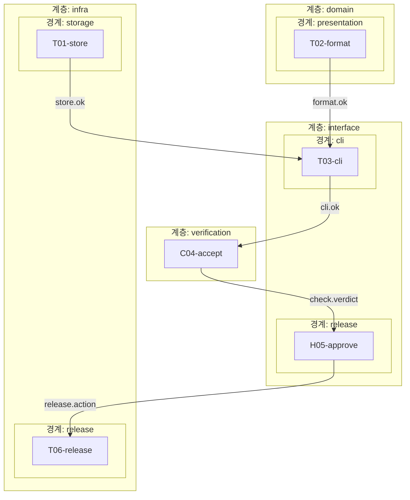

<!-- harness/render.py 가 만든 파일 — 손으로 고치지 않는다 -->
# 계층 · 경계

> 생성 2026-10-31T16:09:39 · graph v1 · Run run-20261031-152503

## 경계를 넘는 계약

| 보내는 계층 | 받는 계층 | 경계를 넘는 필드 (계약) |
| --- | --- | --- |
| domain | interface | format.ok |
| infra | interface | store.ok |
| interface | infra | release.action |
| interface | verification | cli.ok |
| verification | interface | check.verdict |
