<!-- harness/render.py 가 만든 파일 — 손으로 고치지 않는다 -->
# 실행 그래프

> 생성 2026-11-01T14:32:21 · Run run-20261031-152503

```mermaid
flowchart LR
  IN(["입력"])
  DONE((("완료")))
  STOP((("중단")))
  C04_accept["C04-accept<br/>CODE<br/>실행 1 · 시도 1"]
  class C04_accept executed
  H05_approve{{"H05-approve<br/>HUMAN<br/>실행 1 · 시도 1"}}
  class H05_approve executed
  T01_store("T01-store<br/>AGENT<br/>실행 1 · 시도 1")
  class T01_store executed
  T02_format("T02-format<br/>AGENT<br/>실행 1 · 시도 1")
  class T02_format executed
  T03_cli("T03-cli<br/>AGENT<br/>실행 1 · 시도 3")
  class T03_cli executed
  T06_release["T06-release<br/>CODE<br/>실행 1 · 시도 1"]
  class T06_release executed
  T03_cli -->|"cli.ok == true"| C04_accept
  C04_accept -->|"check.verdict == pass"| H05_approve
  IN -->|"todo_file exists"| T01_store
  IN -->|"todo_file exists"| T02_format
  T01_store -->|"store.ok == true"| T03_cli
  T02_format -->|"format.ok == true"| T03_cli
  H05_approve -->|"release.action == release"| T06_release
  T06_release -->|"release.status == done"| DONE
  H05_approve -->|"release.action == stop"| STOP
  classDef pending fill:#f4f4f5,stroke:#a1a1aa,color:#3f3f46
  classDef ready fill:#dbeafe,stroke:#2563eb,stroke-width:3px,color:#1e3a8a
  classDef running fill:#fef9c3,stroke:#ca8a04,color:#713f12
  classDef waiting_human fill:#ffedd5,stroke:#ea580c,stroke-width:3px,color:#7c2d12
  classDef executed fill:#dcfce7,stroke:#16a34a,color:#14532d
  classDef failed_retryable fill:#fce7f3,stroke:#db2777,color:#831843
  classDef failed fill:#fee2e2,stroke:#dc2626,stroke-width:3px,color:#7f1d1d
  classDef skipped fill:#fafafa,stroke:#d4d4d8,stroke-dasharray:4 3,color:#a1a1aa
  classDef draft fill:#ffffff,stroke:#a1a1aa,stroke-dasharray:4 3,color:#52525b
  class IN,DONE,STOP pending
```

| 모양 | 종류 |  | 색 | 상태 |
| --- | --- | --- | --- | --- |
| 사각형 | CODE |  | 파랑 굵은 테 | ready (지금 실행 가능 · 같이 있으면 병렬 웨이브) |
| 둥근 사각형 | AGENT |  | 초록 | executed |
| 육각형 | HUMAN |  | 주황 굵은 테 | waiting_human (역질문 중) |
| 화살표 | requires (그 조건이 참이면 준비) |  | 빨강 / 분홍 | failed / failed_retryable |
|  |  |  | 회색 점선 테 | 아직 Run 없음 (draft) · skipped |

## 노드

| 노드 | 종류 | 상태 | REQ | 스펙 |
| --- | --- | --- | --- | --- |
| C04-accept | CODE | executed | REQ-F1, REQ-F2, REQ-N1 | [specs/nodes/C04-accept.md](../specs/nodes/C04-accept.md) |
| H05-approve | HUMAN | executed | REQ-F4 | [specs/nodes/H05-approve.md](../specs/nodes/H05-approve.md) |
| T01-store | AGENT | executed | REQ-N1 | [specs/nodes/T01-store.md](../specs/nodes/T01-store.md) |
| T02-format | AGENT | executed | REQ-F2 | [specs/nodes/T02-format.md](../specs/nodes/T02-format.md) |
| T03-cli | AGENT | executed | REQ-F1, REQ-F3 | [specs/nodes/T03-cli.md](../specs/nodes/T03-cli.md) |
| T06-release | CODE | executed | REQ-F4 | [specs/nodes/T06-release.md](../specs/nodes/T06-release.md) |
