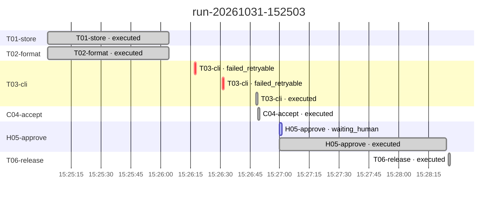

<!-- harness/render.py 가 만든 파일 — 손으로 고치지 않는다 -->
# 타임라인

> 생성 2026-11-01T14:32:21 · Run run-20261031-152503

**DONE** · ready: - · 대기: - · 시도 8

## 사건 (실패 · 역질문 · 사람의 답)

| seq | 시각 | 사건 | 노드 | 내용 |
| --- | --- | --- | --- | --- |
| 10 | 15:26:18 | 실패 | T03-cli | [contract_violation] 게이트 exit 1 (기대 0) — evidence\T03-cli\r01a01\gate.log |
| 12 | 15:26:31 | 실패 | T03-cli | [contract_violation] 게이트 exit 1 (기대 0) — evidence\T03-cli\r01a02\gate.log |
| 21 | 15:27:00 | 역질문 대기 | H05-approve | 수용 시나리오 PASS — 배포 승인 필요 |
| 22 | 15:28:24 | 사람의 답 | H05-approve | release — 사용자가 AskUserQuestion 에서 release 선택 (리허설) |
| 29 | 15:28:25 | Run 종료 | - | SUCCESS |

자세히: [DECISIONS](../memory/DECISIONS.md) · [TROUBLESHOOTING](../memory/TROUBLESHOOTING.md) · `trace/events.jsonl` 의 seq
